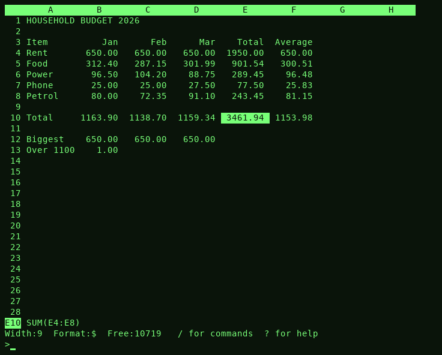
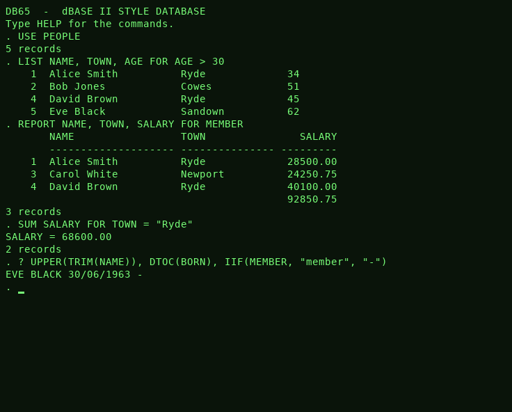

# SBC65 on Cyclone 10 LP

An OSI-style 65C02 single-board computer, running a ROM-resident OS-65D V3.3 DOS, rebuilt in a Cyclone 10 LP FPGA (10CL006YE144C8G core board) with external SRAM, a built-in composite-video terminal, a PS/2 keyboard and SD-card "disks".

The blog about the project, CALC65 and DB65: **[blog.bartvoip.co.uk](https://blog.bartvoip.co.uk)**.

- **CPU:** 65C02 at 1 MHz (50 MHz / `CPU_DIV`)
- **Console:** 6850 ACIA, 8N1, 19200 baud by default, 3.3 V TTL
- **Display:** 80 × 32 text on composite video (PAL, or NTSC 80 × 28)
- **Storage:** up to 256 OS-65D disk images on a raw SD card

## Memory map

| Address | What |
|---|---|
| `$0000-$BFFF` | RAM 48K, AS6C1008 SRAM (A16 held low, 64K spare) |
| `$A000-$BFFF` | Forth ROM 8K (on-chip) in place of that RAM while Forth runs: `FT` switches it in, `BYE` / F10 / power-up switch it out. The RAM underneath is kept. |
| `$C000-$C01F` | reads `$FF` (old disk PIA/ACIA, not fitted) |
| `$C080-$C081` | 6850 ACIA console (mirrored to `$C08F`) |
| `$C090-$C09F` | minimal VIA: ORB/IRB (`$C090`), DDRB (`$C092`) only. Port B: PB0 SD CLK, PB1 SD DI, PB2 SD CS (outputs), PB6 SD CD, PB7 SD DO (inputs). Other registers read `$FF`. |
| `$C0A0` | bank latch (reads back too): bit 0 = 1 Forth ROM at `$A000`, bit 1 = 1 [OSI mode](#osi-mode), bit 2 = OSI keyboard polarity |
| `$C100-$CFFF` | ROM (on-chip): SD card driver + `MO` command (`rom/SD.S`), `DA` disassembler (`rom/DIS.S`) |
| `$D000-$DFFF` | ROM 4K (on-chip): DOSX extension commands (in [OSI mode](#osi-mode): screen RAM `$D000-$D7FF`, keyboard `$DF00`) |
| `$E000-$FFFF` | ROM 8K (on-chip): OS-65D DOS |

The cold start finds RAM up to `$BFFF`, so BASIC shows 34177 BYTES FREE and the assembler has about 34K for source.

> **Note:** this differs from the real SBC (ACIA `$8000`, VIA `$9000`, 32K RAM). Programs that use the ACIA or VIA directly need the new addresses. The ROM source builds either way (see [Changing things](#changing-things)).

On-chip memory: 24 ROM + 4 screen + 2 character set = 30 of 30 M9K (full).

## Built-in terminal

The composite screen and PS/2 keyboard work as a terminal on the console: everything the CPU sends through the ACIA appears on the screen (and on the serial port), and key presses arrive through the ACIA receiver alongside the serial port. No software changes are needed.

- **Screen:** 80 × 32 (5×7 characters in 6×8 cells), PAL 50 Hz (or NTSC with F9), blinking block cursor, hardware scrolling. Lines exactly 80 wide do not leave a blank line (the wrap waits for the next character).
- **Control codes:** CR, LF, BS, TAB, FF (clear), and the VT100 sequences `ESC[nA/B/C/D`, `ESC[r;cH`, `ESC[J` (0/1/2), `ESC[K` (0/1/2), `ESC[7m` / `ESC[0m`, `ESC c`. Others are ignored.
- **Keyboard:** UK layout, Caps Lock starts ON (LED follows), arrow keys send `ESC [ A/B/C/D`, Shift+3 sends `#`. F10 resets the computer.
- **F9** switches between PAL (50 Hz, 80 × 32) and NTSC (60 Hz, 80 × 28; an NTSC picture has no room for 32 rows). It starts as PAL at power-up and keeps its setting over an F10 reset.

## OSI mode

For OSI BASIC programs that PEEK and POKE the screen and keyboard as on a Challenger 2P/4P. Turn it on and off from BASIC:

```
POKE 49312,2     OSI mode on   ($C0A0 bit 1)
POKE 49312,6     on, with the keyboard polarity inverted (bit 2, see below)
POKE 49312,0     off
```

While it is on:

| Address | What |
|---|---|
| `$D000-$D7FF` | Screen: 32 rows of 64 bytes (`53248 + row*64 + col`), read and write, shown as 64 × 32 on the TV in 8 × 8 cells with the OSI character set |
| `$DF00` | OSI keyboard matrix (57088), worked by the PS/2 keyboard (it answers all through `$D800-$DFFF`) |

- The OSI screen *is* the terminal's screen, so `PRINT` output and POKEs land on the same 64 × 32 picture, and PEEK reads back whatever is shown. The terminal wraps at 64 columns, and the cursor is hidden.
- While a DOS command from DOSX runs (from when code at `$D000-$DFFF` is run until code is next run from RAM), `$D000-$DFFF` is the ROM, so DOS commands keep working without leaving OSI mode. BASIC and programs in RAM see the screen and keyboard. F10 switches OSI mode off.
- Diagnostics: `PEEK(57089)` (`$DF01`) gives the last PS/2 key code pressed.
- **Keyboard ($DF00):** write a row-select byte, then read which keys in that row are down. Key positions are the OSI keyboard's (as in MAME's OSI driver). SHIFT LOCK follows Caps Lock (on at power-up). The PS/2 keys used are the letters, digits and punctuation, Space, Enter (RETURN), Backspace (RUB OUT), Esc and Tab (ESC), Ctrl, both Shifts, `[` (LINE FEED) and `#` (REPEAT). PS/2 `-` is the OSI `:` key and PS/2 `=` is the OSI `-` key.
- **Polarity:** with bit 2 = 0 (the default), a 0 in the row byte selects a row and a key that is down reads as 0, as on the Challenger 1P/Superboard. Bit 2 = 1 inverts both. If a program's keys don't respond, try `POKE 49312,6`.
- Keys still reach the ACIA too, so `INPUT` works. Keys pressed during a game may be waiting when the program ends.

### Example: Hangman

`basic/HANGMAN_FPGA.BAS` is David Tewksbary's Hangman for the C1P, converted to OSI mode. It shows what an old program usually needs:

- a row step of 64 instead of 32 (`LL=64`), with fixed screen addresses moved to the same row and column in the 64-byte layout
- `POKE 49312,2` at the start and `POKE 49312,0` at the end
- the C1P-only lines taken out: `DISK!"CA ..."` screen drivers, `POKE 55296` (C1P 32/64-column mode), and pokes into OS-65D's workspace
- a subroutine (line 9000) that throws away keys waiting at the serial input before `INPUT`. Keys reach both `$DF00` and the ACIA.

Its keyboard code needed no change, because the C1P matrix and polarity are the defaults here.

### OSI character set

The 2K character ROM (`rtl/font_pkg.vhd`) holds the terminal's own letters at `$20-$7F` and the OSI graphics at `$00-$1F` and `$80-$FF`, taken from a dump of a Compukit UK101 AM2716 character generator (`rom/osi/AM2716_CHARGEN.BIN`), the UK101's copy of the OSI character set. Terminal mode makes its inverse video in logic, so it no longer needs those slots. The UK101 ROM stores bit 0 as the leftmost pixel, so it is built with `--mirror`:

```
python tools/make_osi_font.py --mirror rtl/font_pkg.vhd rtl/font_pkg.vhd rom/osi/AM2716_CHARGEN.BIN
```

OSI mode uses no extra memory blocks.

### Simulation

`sim/osi/run_osi.sh` (GHDL + cc65) runs `osi_test.s` in place of the ROM. It checks PEEKs of printed text, POKE/PEEK (also through `(zp),Y` as BASIC does), PRINT in OSI mode, the `$DF00` matrix in both polarities, that DOSX code still reads its ROM, and that ROM routines called by DOSX (its message printing) do too. Then it grabs a frame (`sim/frame_osi_simulated.png`). `sim/osi/term/` draws a terminal-mode test picture with two copies of the VHDL, so they can be compared pixel by pixel. With this change the frames are identical.

## SD card "disks"

The DOS's floppy routines go to `rom/SD.S`, which drives the SD card through VIA port B. The card holds up to 256 disk images (slots 0-255). After power-up drives A-D are slots 0-3; `MO` mounts any slot on any drive:

```
MO          list the mounts      A=000 B=001 C=002 D=003
MO B 12     drive B = slot 12
```

The mount table is at `$35F0-$35F5` in unused DOS RAM.

All DOS commands work as before (`DI`, `BA`, `AS`, `LO`, `PU`, `SA`, `CA`, `IN`, `EX`, `SE A-D`, DOSX's `CO`/`VE`/`RN` …). `IN` formats a track on the card.

**Errors:** #1 read failed, #2 write failed, #6 no card, #A no such sector.

The driver keeps nothing in zero page while sector data is arriving, so the cold start's load of track 06 sector 3 into page 0 is exact.

The same ROM works on the real SBC with the SD module on its VIA (PB0 CLK, PB1 DI, PB2 CS, PB7 DO): `rom/EEPROM_8000-FFFF_SD.bin`.

### Making a card

The card has no PC file system; it is written as a raw image. Build `tools/hfe2sd.c` (e.g. in Dev-C++), then:

New card (replaces everything on it):

```
hfe2sd card.img PBdos.HFE GAMES.HFE      (slots 0, 1, ...)
hfe2sd card.img 0=PBdos.HFE 12=WORK.HFE  (chosen slots, - = empty)
```

and write `card.img` to the card with Win32 Disk Imager.

Add or replace a disk, keeping the rest of the card (Command Prompt run as administrator; N = the card's disk number in Disk Management):

```
hfe2sd -a \\.\PhysicalDriveN 12=WORK.HFE
hfe2sd -a \\.\PhysicalDriveN 12=-        (empty slot 12)
hfe2sd -l \\.\PhysicalDriveN             (list the slots)
```

`-a` and `-l` also work on an image file. They only touch a card that hfe2sd labelled ("SBC65 SD CARD" in block 0), so a wrong disk number is refused. Cards made before this version have no label: make them once more without `-a`. If Windows offers to format or initialise the card, click Cancel (initialising would overwrite the label).

## DOS commands

The full list of ROM DOS commands, with what each one does, is in [DOS_COMMANDS.md](DOS_COMMANDS.md).

## CALC65 spreadsheet

A SuperCalc 2 style spreadsheet in 65C02 assembler, for this FPGA version. It has 26 × 128 cells, 12-digit decimal arithmetic, formulas and functions (SUM, AVERAGE, MIN, MAX, COUNT, ABS, INT, IF), and replicate, insert and delete. Sheets are saved to disk by name. Load `calc65/CALC65.HEX` with `HL`, then type `GO 4000`. See [calc65/README.md](calc65/README.md).



## DB65 database

A dBASE II style database in 65C02 assembler, for this FPGA version. You type commands at a dot prompt: CREATE, USE, APPEND, EDIT, BROWSE, LIST/DISPLAY ... FOR, REPORT, REPLACE, DELETE/PACK, COUNT/SUM, SORT and more. Fields are text, numbers, dates and Yes/No, and expressions work as in dBASE. Each database is an ordinary DOS file of up to 32 tracks, read and written a track at a time. Load `db65/DB65.HEX` with `HL`, then type `GO 3B00`. See [db65/README.md](db65/README.md).



## DA - 65C02 disassembler

`rom/DIS.S`, in the `$C100` ROM after the SD driver.

```
DA E000        20 instructions, then any key = 20 more, ESC = stop
DA E000 E0FF   E000 through E0FF (ESC stops, space pauses, as MD)
```

Output looks like:

```
E000  4C A5 F4  JMP  $F4A5
C200  0F 12 FD  BBR0 $12,$C200
```

- All 212 W65C02S opcodes (RMB/SMB/BBR/BBS, WAI, STP included); unused opcodes show as `???` and count as one byte.
- Branch targets are worked out.
- It reads what it lists, so avoid the I/O page.
- At the DOS prompt `$A000-$BFFF` is RAM. To list the Forth ROM, switch it in first: `MF C0A0 C0A0 01`, then `DA A000`, then `MF C0A0 C0A0 00`.
- The tables in `DIS.S` are made by `tools/gentab.py` from `tools/optab.py`.

## Pins

All set in `sbc65.qsf`.

| Signal | Pin(s) |
|---|---|
| clk50 | 91 (no reset pin; press F10 on the keyboard) |
| uart_txd / uart_rxd | 33 / 34 |
| av_sync_n / av_video | 31 / 32 |
| ps2_data / ps2_clk | 84 / 85 |
| SRAM A16..A1 | 39 43 46 50 52 54 58 60 65 67 69 71 73 75 77 83 |
| SRAM A0 | 28 |
| SRAM D7..D0 | 42 44 49 51 53 55 59 66 |
| SRAM /CE, CE2, /OE, /WE | 68, 70, 72, 74 |
| SD module CS, DI, DO, CLK, CD | 132, 135, 137, 141, 143 (module 5V/GND to 5V) |

## Files

| Path | What |
|---|---|
| `sbc65.qpf` / `.qsf` / `.sdc` | Quartus Prime Lite project |
| `rtl/sbc65_top.vhd` | top level: clocks, reset, decode, SRAM, ROM, bus |
| `rtl/mem_blocks.vhd` | ROMs, screen RAM, font ROM (Quartus templates) |
| `rtl/terminal.vhd` | on-screen terminal (VT100 subset, scrolling) |
| `rtl/acia6850.vhd` | 6850-compatible ACIA (+ keyboard input path) |
| `rtl/vdu_composite.vhd` | 80×32 text display, composite sync + video |
| `rtl/ps2_kbd.vhd` | PS/2 scan codes → ASCII, 8-byte buffer; raw key events for OSI mode |
| `rtl/font_pkg.vhd` | 6×8 character set (Adafruit-GFX 5×7 font, BSD) |
| `rtl/rom_image_pkg.vhd` | ROM contents, generated from `rom/ROM_FPGA48.bin` (run bin2vhd on `testrom/testrom.bin` for the test ROM) |
| `rom/` | `ROM.S` + `DOSX.S` + `SD.S` + `DIS.S`, `rom.cfg`, and the built 32K images: `ROM_FPGA48.bin` (this FPGA, 48K layout) and `EEPROM_8000-FFFF_SD.bin` (the real SBC) |
| `rtl/cpu65c02/` | cpu65c02_true_cycle by Jens Gutschmidt (OpenCores, GPL v3). Changes: removed the simulation-only `FOR ALL ... USE ENTITY` lines, and fixed a bug in `reg_pc.vhd` (JMP abs at `$xxFE` fetched its high address byte from the wrong page: no carry). |
| `testrom/` | test ROM source (ca65) and the built `testrom.bin` |
| `tools/bin2vhd.c` | converts a ROM `.bin` to `rom_image_pkg.vhd` |
| `tools/hfe2sd.c` | builds an SD card image from Gotek HFE files |
| `tools/optab.py`, `tools/gentab.py` | W65C02S opcode map and the generator for the `DIS.S` tables |
| `tools/make_font6_pkg.py` | rebuilds `font_pkg.vhd` from Adafruit `glcdfont.c` |
| `tools/make_font_pkg.py` | the old 8×8 font (for the 64-column version) |
| `DOS_COMMANDS.md` | reference list of the ROM DOS commands |
| `calc65/` | CALC65 spreadsheet: source, `CALC65.HEX`, guide, emulator test tools |
| `db65/` | DB65 database: source, `DB65.HEX`, guide, emulator test tools |
| `sim/` | GHDL testbenches and run script |

## Building and running

1. Open `sbc65.qpf` in Quartus Prime Lite and compile.
2. Program `output_files/sbc65.sof` with the USB-Blaster (lost at power off). To make it permanent: File > Convert Programming Files > `.jic`, configuration device EPCS16 (the board's Winbond 25Q16), flash loader 10CL006Y, add `sbc65.sof`, then program the `.jic`.
3. The build boots the OS-65D ROM straight to the `A*` prompt; with an SD card made by hfe2sd, `DI`, `BA` etc. work.

With the test ROM instead (`bin2vhd testrom/testrom.bin rtl/rom_image_pkg.vhd`) the screen (and the serial terminal) show:

```
SBC65 FPGA - Cyclone 10 LP
65C02 opcodes: OK
SRAM $0200-$7FFF: OK
Terminal:  inverse  normal                 (middle word inverted)
Type something:
```

… and "<- row 20 col 45" further down the screen. Anything typed is echoed exactly as typed.

## Changing things

**Baud rate:** the `BAUD` generic in `sbc65_top.vhd` (the 6850's divide-select bits are accepted but the rate is fixed by this generic).

**CPU speed:** the `CPU_DIV` generic (even, at least 10, so 5 MHz max with the SRAM). If you change it, change `-divide_by 50` in `sbc65.sdc`.

**The ROM:** build `bin2vhd.c` (e.g. in Dev-C++), then from the project folder:

```
bin2vhd ROM.bin rtl\rom_image_pkg.vhd
```

A 32K file is taken as `$8000-$FFFF` (an EEPROM image); the `$A000-$BFFF`, `$C100-$DFFF` and `$E000-$FFFF` parts go into the FPGA. An 8K file is placed at `$E000`. Recompile in Quartus.

To rebuild the ROM for this FPGA (48K RAM, I/O at `$C080`), in `rom/`:

```
ca65 ROM.S -o rom.o
ld65 -C rom.cfg -o ROM_FPGA48.bin rom.o
bin2vhd ROM_FPGA48.bin ..\rtl\rom_image_pkg.vhd
```

For the real SBC (32K RAM, ACIA `$8000`, VIA `$9000`):

```
ca65 -D FPGA48=0 ROM.S -o rom.o
ld65 -C rom.cfg -o EEPROM_8000-FFFF_SD.bin rom.o
```

The test ROM in `testrom/` still uses the old `$8000` ACIA, so it does not run on this layout.

**Sync wiring:** if the picture rolls or is inverted, the board's resistor network may expect the opposite polarity on pin 31 or 32.

## Licence

This project is released under the GNU General Public License v3; see [LICENSE](LICENSE). The 65C02 core in `rtl/cpu65c02/` is GPL v3 by Jens Gutschmidt. The character set in `rtl/font_pkg.vhd` comes from Adafruit-GFX under its BSD licence (`tools/LICENSE_Adafruit_GFX_font.txt`). OS-65D is Ohio Scientific's software; `rom/ROM.S` contains a disassembly of it, modified to run from ROM.
