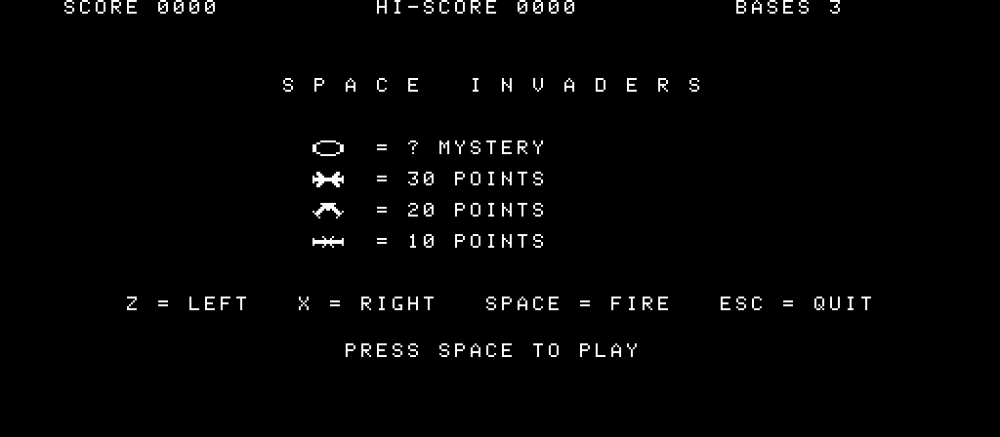
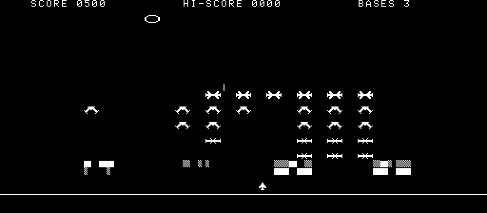

# Space Invaders

A Space Invaders clone in 65C02 machine code for the SBC65 FPGA. It uses OSI mode: the 64 × 32 screen at `$D000` with the OSI character set, and the keyboard matrix at `$DF00`.

## Loading and playing it

1. At the DOS prompt, type `HL` and send `INVADERS.HEX`.
2. Type `GO 4000`. The game switches OSI mode on itself.
3. Save it with `MS 4000 49FF INVADERS`. After that, `MR INVADERS` loads and starts it.

| Key | What it does |
|---|---|
| Z | Left |
| X | Right |
| Space | Fire (and starts a game from the title screen) |
| ESC | Quits to the DOS, with OSI mode switched off |

The game has:

- 55 invaders in five rows, worth 10, 20 and 30 points, which march down and speed up as you thin them out;
- four shields that wear away, a mystery saucer, bombs from the invaders, three bases, and the high score.

When the last invader goes, a new wave starts. The game ends if the invaders reach your base.

## Files

| File | What it is |
|---|---|
| `INVADERS.S` | The source, for ca65: `ca65 --cpu 65C02 INVADERS.S -o INVADERS.o` then `ld65 -C invaders.cfg INVADERS.o -o INVADERS.BIN` |
| `INVADERS.HEX` | Intel HEX at `$4000`, ready for `HL` |
| `INVADERS.ASM` | The same game in OSI Assembler (AS) format, with 65C02 instructions, made by `ca65_to_osi.py`. It assembles to the same code, apart from two `INC A`s written as `CLC`/`ADC #1`. |

The speed is set by the `ldx #11` in `FRAME`. A bigger number makes the game slower.
