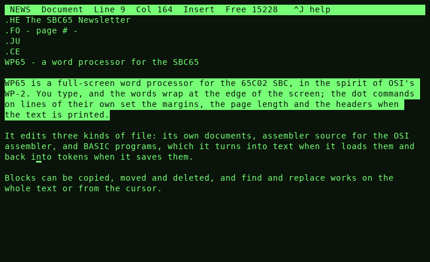

# WP65

WP65 is a full-screen word processor for the SBC65 FPGA computer (48K RAM) running the OS-65D V3.3 ROM DOS. It is written in 65C02 assembler, in the spirit of OSI's WP-2, and uses WordStar-style control keys. It works on any 80-column VT100 terminal on the console: the FPGA's built-in screen, PuTTY, or the CYD and JC3248 terminals.

- **The whole document is in memory:** about 14,000 characters. The status line shows how much room is left.
- **Word wrap:** you type, and words wrap at the edge of the screen. RETURN ends a paragraph.
- **Find and replace:** search the whole text or from the cursor, with or without asking at each match.
- **Blocks:** mark a block, then copy, move or delete it.
- **Mail merge:** prints a letter once for each record in a DB65 database, filling in the fields.
- **Printing:** with margins, justification, page length, headers and footers, set by dot commands. You can view the result on the screen, or send it to the console.
- **Three kinds of file:**
  - WP65 documents.
  - Assembler source for the OSI Assembler (AS).
  - BASIC programs: WP65 turns them into text when it loads them and back into tokens when it saves them.



## Loading and running it

1. At the DOS prompt, type `HL` and send `WP65.HEX`. HL finishes by itself.
2. Type `GO 3B00`.
3. Save it to disk once with `MS 3B00 6DFF WP65` (7 tracks). After that, `MR WP65` loads and starts it.

The screen starts at 24 lines. For the FPGA's own 80 × 32 screen, press `^KZ` and enter 32. Then save the program again with `MS` so that it starts that way. (The setting is the byte at `$3B03`.)

## The screen

The top line shows:
- the drive and file name, as `B:LETTER`, with `*` if the text has changed since it was saved;
- the file type (Document, Assembler or BASIC);
- the line and column of the cursor;
- Insert or Over;
- the free space.

Messages and questions also appear on the top line. ESC cancels any question.

## Keys

`^` means hold CTRL. The arrow keys work, and so do the WordStar diamond keys.

| Keys | What they do |
|---|---|
| arrows, or `^E` `^X` `^S` `^D` | up, down, left, right |
| `^A` / `^F` | a word left / right |
| `^R` / `^C` | a screen up / down |
| `^QS` / `^QD` | the start / end of the line |
| `^QR` / `^QC` | the top / end of the text |
| RETURN | a new line (or paragraph) |
| BS (or DEL) | delete the character on the left |
| `^G` | delete the character under the cursor |
| `^T` | delete the word on the right (at the end of a line, join the next line on) |
| `^Y` | delete the whole line |
| `^N` | split the line at the cursor |
| `^V` | switch between Insert and Overwrite |
| `^QF` | find |
| `^QA` | find and replace |
| `^L` | find (or replace) again |
| `^KB` / `^KK` | mark the beginning / end of a block (shown in reverse) |
| `^KC` | copy the block to the cursor |
| `^KV` | move the block to the cursor |
| `^KY` | delete the block |
| `^KH` | hide or show the block |
| `^QB` / `^QK` | go to the beginning / end of the block |
| `^KL` | load a file |
| `^KR` | read a file in at the cursor (it becomes the block) |
| `^KS` | save |
| `^KX` | save and exit to the DOS |
| `^KQ` | quit without saving (it asks first if the text has changed) |
| `^KT` | set the file type: Document, Assembler or BASIC |
| `^KP` | print: V views it on the screen, P sends it to the console |
| `^KF` | the directory of a drive: press A–D, or RETURN for the default drive. The drive you pick becomes the default. |
| `^KZ` | the number of screen lines |
| `^J` | help |

**Find options.** After the text to find, WP65 asks for options. You can type any of these letters, or none:
- `U`: ignore upper and lower case.
- `G`: search the whole text from the top, not from the cursor.
- `N`: replace without asking (find and replace only).

When it asks at a match, answer:
- `Y`: replace this one.
- `N`: skip it.
- `A`: replace all the rest without asking.
- ESC: stop.

## Printing

`^KP` then `V` shows the printed pages on the screen. It pauses each time the screen is full; press any key to go on, or ESC to stop.

`^KP` then `P` sends the pages to the console without stopping. Turn on capture in your terminal program first (in PuTTY, Session logging) if you want to keep the result or send it to a printer.

In a document, a line that starts with one of these dot commands sets up the printing. The line is not printed.

| Command | What it does | Default |
|---|---|---|
| `.LM n` | left margin | 5 |
| `.RM n` | right margin (column) | 75 |
| `.PL n` | page length in lines | 66 |
| `.LS n` | line spacing (2 = double) | 1 |
| `.HE text` | header at the top of each page; `#` is replaced by the page number | none |
| `.FO text` | footer at the bottom of each page | `- # -` |
| `.CE [n]` | centre the next line (or the next n lines) | |
| `.JU` / `.NJ` | justify on / off: lines line up on the right margin too | off |
| `.NF` / `.FI` | no fill: print lines as they are typed / fill again | fill |
| `.PA` | start a new page | |
| `.SP [n]` | n blank lines | 1 |
| `.DF name` | mail merge with this DB65 database (see below) | |

Words fill each line between the margins, and runs of spaces between words become one space. Spaces at the start of a paragraph are kept as an indent. A blank line prints as a blank line.

### Mail merge

Put a `.DF` line in a document, naming a DB65 database (with its drive if needed), and write field names between `&` signs where the record's data should go:

```
.DF B:PEOPLE
.HE &NAME&
Dear &NAME&,

Your subscription for &TOWN& runs out on &RENEW&.
```

`^KP` then prints the whole document once for each record, each copy starting on a new page with its page numbers starting again at 1. Deleted records are left out. Field names can be in capitals or small letters.

How the fields are printed:
- **Text:** without the spaces around it.
- **Numbers:** as DB65 stores them, without the spaces in front.
- **Dates:** as DD/MM/YYYY. An empty date prints as nothing.
- **Logical fields:** Y or N.
- **Other `&`:** an `&` that isn't part of a field name is printed as it is, so `Fish & chips` and `&NOFIELD&` come out unchanged.

To print for only some records, mark the others as deleted in DB65, for example `DELETE FOR TOWN <> "RYDE"`; `RECALL ALL` brings them back afterwards. Or work on a copy: `SORT ON NAME TO B:LETTERS`, then `USE B:LETTERS` and delete the records you don't want there. This also prints the letters in name order.

Assembler and BASIC files are printed as listings instead: each line as it is, with the file name and page number at the top of each page.

## Drives

A file name can start with its drive: `B:LETTER`. Without a drive, the default drive is used.
- **Default drive:** the one the DOS was on when WP65 started. `^KF` changes it.
- **Save:** `^KS` offers the name with its drive, so a file loaded from B goes back to B.
- **Read in:** `^KR` can read a file from any drive.
- **On quitting:** WP65 puts the DOS back on the drive it started on.

## Files

WP65 reads and writes the same workspace file format as the OS-65D `PU` and `LO` commands: a memory image starting at `$xx79`, one track (2K) per sector. The first five bytes are the start address, the end address and the number of tracks. The low byte of the start address gives the type:

| Start | Type | How the text is stored |
|---|---|---|
| `$3A7D` | WP65 document | the text itself, from byte 5, with CR at the end of each line |
| `$327E` | Assembler source | each line is a line number (2 bytes) then the text then CR; a byte of `$80`-`$FF` repeats the character before it |
| `$3A7F` | BASIC program | tokenized BASIC lines with their links, as BASIC keeps them in memory |

When WP65 saves a file, it makes it with `MS` and writes it a track at a time, so `DI` lists it and `DE` deletes it. The file is made just big enough. If a file of that name exists already, it is replaced.

**Assembler source.**
- When WP65 loads a file, it drops the line numbers.
- When it saves a file, it numbers the lines 10, 20, 30 and so on, and packs runs of spaces as AS does.
- `TY` shows the file with its line numbers. It is the layout AS keeps its source in, so AS should load it as usual; this has not been tried on the board yet.

**BASIC programs.**
- WP65 uses BASIC's own keyword table to turn tokens into words and back. That table is only in memory once BASIC has been run, so run `BA` once after starting the computer, `EXIT` back to the DOS, and then start WP65.
- Each line must start with its line number, and the line numbers must go up.
- When WP65 saves the program, it turns keywords into tokens as BASIC does. It does not change text in quotes, after `REM`, or after `DATA` up to the next `:`. `?` becomes `PRINT`.
- Blank lines are left out.
- Lines in an assembler or BASIC file can be up to 250 characters long.

Documents are word-wrapped on the screen. Assembler and BASIC files are not: a line longer than the screen just carries on onto the next screen line.

## Memory

| Address | Use |
|---|---|
| `$3B00`-`$6DFF` | the program |
| `$6E00`-`$75FF` | its variables |
| `$7600`-`$7DFF` | one track of the file being loaded or saved (and the directory) |
| `$7E00`-`$87FF` | a copy of the screen, so only the changes are sent (while printing, the mail merge header and record) |
| `$8800`-`$BFFF` | the text |
| `$30`-`$AF` | zero page, saved at the start and put back at the end |

## Building

```
ca65 --cpu 65C02 WP.S -o WP.o
ld65 -C wp.cfg WP.o -o WP.BIN
python3 tools/mkhex.py WP.BIN 3B00 WP65.HEX
```

The source is in four files:
- `WP.S`: the editor, the screen and the keys.
- `WPIO.S`: the console and the DOS calls.
- `WPFILE.S`: loading and saving.
- `WPEXTRA.S`: blocks, find and replace, and printing.

`tools/` has the py65 emulator used to test it, with a simulated disk and a VT100 screen (`emu.py`), and the BASIC and assembler file builders (`kw.py`).

WP65 has been tested in that emulator, but not yet on the board.
